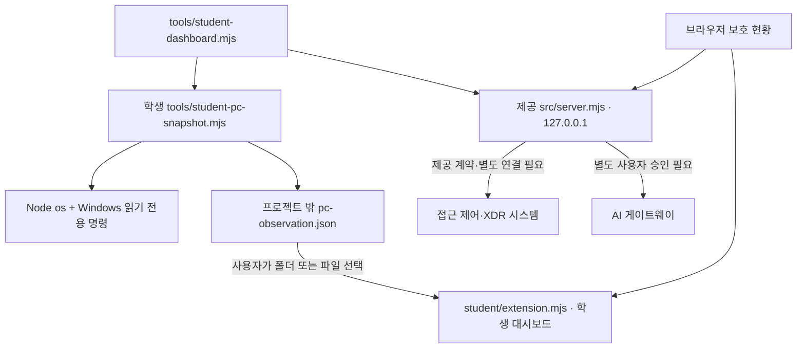

# 케셰브 마무리 제작 · 실행·시연·근거

학생 버전: `final-dashboard-2026.11.04-preview` — **검증 중**. 작성일 2026-11-04(Asia/Seoul).
화면: 관제 대시보드형. 배포 형태: 포장 없이 프로젝트 폴더에서 Windows 로컬 실행.
기준 기록: 22단계 `55c987fefa9cc1a36e83b95b83c4b74c37453bd1`에서 새 브랜치 `codex/final-dashboard`로 이어 작업했다. 앞 단계 원문과 Git 기록은 보존한다. 이 기준 해시는 이번 수정 후 최종 커밋을 뜻하지 않는다. 제출할 해시는 마지막 `git rev-parse HEAD`와 원격의 실제 값으로 확인한다.

## 1. 핵심 기능과 제공 부분

| 핵심 기능 | 학생이 추가한 부분 | 값의 출처 | 현재 한계 |
|---|---|---|---|
| 내 PC 실측 | 상태 카드 4개 중 CPU·메모리·디스크, 표본 추이 | Node `os.cpus()` 전후 차이 약 1초; `os.totalmem/freemem`; Windows `Get-CimInstance Win32_LogicalDisk` | 작업 관리자와 같은 집계 방식이 아니다. 디스크는 프로젝트 볼륨이 아니라 Windows 시스템 드라이브. GiB=2^30 bytes |
| 연결·방화벽 설정 | 활성 어댑터 카드, 프로필별 켜짐/꺼짐 표 | `Get-NetAdapter`, `Get-NetFirewallProfile` | IP·SSID·어댑터 이름을 수집하지 않는다. 어댑터 활성은 인터넷/SDP 접속 성공 증거가 아니다. 프로필 설정과 유효한 모든 방화벽 규칙은 다름 |
| Windows 기록 | System/Application 각각 최근 24시간 Warning=3/Error=2 건수 | `Get-WinEvent -FilterHashtable` | 각 로그 최신 1,001건까지만 조회하고 상한에 닿으면 일부 집계라고 표시. Critical/Information/보안 로그·로그 본문·이벤트 ID는 수집하지 않는다. 침해 판정 아님 |

학생 화면은 `student/extension.mjs`의 `createLocalDashboard`, `normalizePcSnapshot`에 있다. 기존 `createStudentView`가 제공 보호 현황 패널 앞에 **학생 소유 section 하나만 추가**한다. 기존 렌더러 8개, data-* 계약과 제공 메뉴는 유지한다. DOM은 `createElement`·`textContent`로 작성하며 HTML 문자열을 해석하지 않는다. 기존 제공 CSS의 카드·표·버튼·포커스 표현을 재사용한다.

| 파일·경계 | 역할 |
|---|---|
| `student/extension.mjs` | 학생 대시보드·파일 형식 검사 + 이전 13~20단계 표시 함수 8개 |
| `tools/student-pc-snapshot.mjs` | 학생 로컬 읽기 전용 측정. 관측 JSON만 프로젝트 밖에 작성 |
| `tools/student-dashboard.mjs` | 학생 실행 도구. 제공 서버와 측정 프로세스를 함께 시작·종료. 설치/포장 도구 아님 |
| `tools/student-dashboard-check.mjs` | 학생 모의 DOM·오류·실측·제공 파일 보존 검사 |
| `public/index.html`, `public/app.js`, `public/style.css` | 제공 화면·요청·메뉴·공통 배치. 수정하지 않음 |
| `src/server.mjs`, `src/engine*`, `src/ai*`, `src/actions*`, `vendor/` | 제공 API·SDP/XDR·AI·조치 서비스. 수정하지 않음 |
| `student/engine-adapter.mjs`, `package.json`, 인증 설정 | 기존 그대로. 기본 `npm start`는 미연결을 표시할 수 있음 |

현재 시작 틀 0.2.14에는 `student/appearance.json`을 읽는 경로와 PC 실측 API가 없다. 지원되는 척하는 설정 파일을 만들거나 제공 서버를 수정하지 않았다. 따라서 관측 파일을 사용자가 직접 선택한다. 전체 앱 테마·아이콘 변경은 하지 않았으며 대시보드 배치만 학생 코드에 추가했다.

## 2. 환경과 실제 작업 위치

실제 작업 폴더는 `C:\Users\USER\Documents\ChatGPT\aleph\stage13-vault`이고 앱 폴더는 그 아래 `on-client`다. 참고 저장소는 앱이 Git 최상위에 있지만 **이 프로젝트는 on-client 아래**이므로 실행 위치를 혼동하지 않는다. 다른 PC에서는 자신의 복제 위치를 사용한다. 이 절대 경로는 실행 코드의 필수 설정이 아니다.

| 항목 | 확인 결과 |
|---|---|
| OS | 현재 Windows PC. 일반 프로세스로 조회; 권한 상승 명령 미사용. 표준 사용자 계정을 새로 만들어 재현한 것은 아님 |
| Node.js / npm | `v24.13.1` / `11.8.0`; 제공 package의 기준은 `24.19.0`. 기준 버전으로의 신규 설치는 미확인 |
| Git / PowerShell | `2.53.0.windows.1` / PowerShell 7 `7.6.5`; Windows 조회는 별도 Windows PowerShell 5.1 프로세스 사용 |
| 브라우저 | Codex 앱 브라우저에서 JSON 파일 선택·키보드 Enter 재조회·성공/실패 확인. 정확한 브라우저 버전과 폴더 선택 API의 실제 조작은 미확인 |
| 외부 의존성 | on-client에는 없음. 새 npm 의존성·lock 변경 없음 |

필요 프로그램은 Node.js, Windows PowerShell, 브라우저이며 Git은 복제·버전 확인용이다. Linux/macOS·휴대폰·설치형 EXE는 지원 확인을 하지 않았다. 학생 통합 실행 도구는 Windows 외 환경에서 실행을 거부한다.

## 3. 처음 실행하기 — 한 단계씩

**확인 1.** 기존 프로젝트 루트에서 새 PowerShell을 열어 다음을 확인한다. 기존 서버를 임의 종료하거나 기존 작업을 삭제하지 않는다.

```powershell
git status --short
git branch --show-current
git rev-parse HEAD
Set-Location .\on-client
node --version
npm.cmd --version
npm.cmd run check
```

**확인 2.** 같은 창에서 학생 실행 도구를 시작한다.

```powershell
node tools/student-dashboard.mjs --port 5227
```

정상 시작 신호는 `케셰브 대시보드: http://127.0.0.1:5227/`, `측정 폴더: ...`, 이어서 `케셰브 로컬 관측 저장 · <UTC 시각>`이다. 서버 시작만으로 계정·AI·SDP 연결 성공을 뜻하지 않는다. 최초 저장까지 약 수초, Windows 조회가 느리면 최대 약 21초 걸릴 수 있다. 창은 실행 중 열린 상태로 둔다.

관측 폴더는 `%LOCALAPPDATA%\Keshev\observations\session-<임의 접미사>`로 실행마다 새로 만든다. 고정 예시 접미사를 입력하지 말고 이번 터미널에 출력된 실제 경로를 사용한다. 원문 JSON의 시각은 UTC이며 화면은 브라우저의 현지 시간대로 표시한다.

**확인 3.** 브라우저에서 <http://127.0.0.1:5227/>를 연다. 「보호 현황」 위쪽 학생 대시보드에서 「측정 폴더 선택」을 누르고 이번 폴더를 고른다. 생성된 파일 이름은 `pc-observation.json`이다. 폴더 권한은 이 관측 폴더만 선택하며 기존 인증·자료 폴더를 선택할 필요가 없다.

폴더 선택을 지원하지 않거나 권한 요청을 원하지 않으면 **관측 JSON 파일 선택**으로 그 파일만 읽는다. 이 경우 「다시 조회」 또는 Enter는 파일 선택 창을 열며 최신 파일을 매번 다시 선택해야 한다. 이전에 읽은 File 객체를 새 실측값이라고 재사용하지 않는다. 파일은 로컬에서 읽으며 업로드 요청을 보내지 않는다.

**확인 4.** CPU·메모리·디스크·어댑터 카드와 출처·측정 시각, 방화벽·로그 표를 읽는다. 값이 없거나 개별 Windows 조회가 실패하면 「확인 불가」다. 2분이 지난 파일은 현재 상태로 표시하지 않는다. 여러 번 새 파일을 읽으면 실제 표본이 추이에 쌓인다. 같은 sampleId를 중복 집계하지 않으며 추이는 최근 12개만 메모리에 보관한다.

**확인 5.** 「다시 조회」에 키보드로 이동해 Enter를 누르고 측정 시각이 갱신되는지 확인한다. 측정 도구는 관측 완료 후 15초 쉬고 다음 관측을 하므로 약 18~21초 간격일 수 있다. 값이 같아도 하드코딩이라고 단정하지 말고 출처·시각을 먼저 확인한다. CPU는 약 1초 평균이며 메모리는 total-free다. 작업 관리자와 비교할 때 단위·표본 시각·캐시/압축 등 집계 방식의 차이를 고려한다.

**확인 6.** 종료는 실행한 PowerShell에서 `Ctrl+C`다. 학생 도구가 시작한 서버·측정 프로세스만 종료하며 기존 파일은 보존한다. 브라우저 주소가 응답하지 않고 관측 파일의 수정 시각이 더는 바뀌지 않는지 확인한다. 재실행은 같은 명령이며 새 관측 폴더를 다시 선택한다.

업무 기록 예제도 함께 보고 싶다면 다음처럼 **별도 실행 시** 지정한다. 기존 실행을 먼저 정상 종료하고 같은 포트로 중복 시작하지 않는다.

```powershell
node tools/student-dashboard.mjs --demo --port 5227
```

이때 제공 업무 자료는 `demo`지만 학생 PC 관측은 실제 로컬 운영체제를 읽는다. 두 출처를 합쳐 실제 SDP 연결 성공이라고 쓰지 않는다. 기본 제공 실행(`npm.cmd start`, `npm.cmd run demo`)도 이전처럼 사용할 수 있으며, 그 명령만 실행하면 학생 PC 측정 도구가 자동 시작되지는 않는다.

## 4. 글로 쓴 구성도



PC 관측 파일에는 사용자명·기기명·IP·로그 본문·토큰이 필요하지 않다. 브라우저가 PowerShell을 직접 실행하거나 학생 대시보드가 인증 정보를 보관하지 않는다. 로컬 파일은 서명된 장치 증명이 아니므로 다른 사람이 만든 JSON을 실제 관측이라고 신뢰하면 안 된다. 외부 공개 주소와 기존 연결 경계는 [21단계 설명서](STUDENT_RUNBOOK.md)를 따른다.

## 5. 1~7일차 수행·근거

아래는 AI가 도구로 관측한 기록이다. 학생이 직접 제삼자에게 시연했다는 진술로 바꾸지 않는다. 화면 캡처와 실행 보고서는 저장소 밖 `../output/`에 보관하며 비밀 설정 파일은 복사하지 않는다. 체크 스크립트는 실행 시각·실제 HEAD·작업 트리 수정 여부·학생 코드 SHA-256을 함께 기록한다. 수정 중 보고서는 커밋만으로 결과를 묶지 않고 파일 해시도 대조한다.

| 일차 | 이번 작업 | 확인한 근거와 범위 | 미확인·남은 한계 |
|---|---|---|---|
| 1 다시 실행 | 기존 22단계 앱을 보존하고 핵심 기능 3개 선정 | 제공 기본 서버 재실행 HTTP 200 / `/api/me` 503 `ENGINE_NOT_CONNECTED`를 실제 확인 | 기존 단계의 포털 통과 상태를 새로 조회하지 않음 |
| 2 PC 상태 | CPU·메모리·디스크 관측·단위·시간·추이 추가 | 실제 로컬 수집 및 실제 브라우저 표시. 예: 2026-11-04 21:10 KST CPU 2.8%, 메모리 14.6/29.7 GiB, 디스크 여유 364.4/882.4 GiB | 값은 당시 표본이며 고정 예시로 UI에 넣지 않음. 작업 관리자와 동시 비교는 미확인 |
| 3 연결·기록 | 네트워크/방화벽/Windows 로그 읽기 | 당시 활성 어댑터 6개, 3개 프로필 켜짐, System 경고90/오류24, Application 경고3/오류4. 실제 조회·실제 화면 확인 | 경고는 공격 판정 아님. 실제 SDP 미연결. 제한된 로그 범위 |
| 4 화면 다듬기 | 4개 카드·추이·기록·상태·다시 조회 | 브라우저 Enter 재조회로 표본이 2개가 됨. 잘못된 테스트 JSON 선택 후 모든 현재 카드가 확인 불가로 바뀌고 과거 표본은 별도 유지됨 | 폴더 선택 경로는 모의 검사와 실제 조작 구분 필요. 기존 제공 전체 화면 스타일 유지 |
| 5 따라 하기 | 이 실행 안내·학생 진입점 추가 | 같은 PC에서 새 프로세스로 시작·Ctrl+C 종료·새 폴더로 재시작 확인. 포트5226/5227 종료와 이전 파일 갱신 중지를 확인 | 다른 사람·별도 PC의 독립 실행은 미확인. 이를 완료로 쓰지 않음 |
| 6 제출 준비 | 학생 변경만 검토·커밋·정상 푸시 | 최종 해시는 `git rev-parse HEAD`, 원격과 대조. 아래 명령 참조 | 자동 포털 제출·포장 실행은 하지 않음 |
| 7 시연·정리 | 아래 시연 순서와 이 문서 | 실제 로컬 측정·모의 오류·원문 확인을 구분해 기록 | 학생 본인의 최종 시연·공식 판정·실제 운영 인증은 미확인 |

학생 자동 검사는 **8건 통과**였다: 제공 코드 보존(원문 비교) 1, 입력/DOM 모의 검사5, 실제 로컬 PC 조회1, 수집 도구 쓰기/통신 없음 원문 검사1. 세부 시각·파일 해시는 [학생 검사 기록](FINAL_VALIDATION.md)에 있다. 이것은 공식 판정이 아니다. 같은 최종 커밋의 회귀 검사 결과는 저장소 밖 별도 보고서에 남기며 과거 22단계 결과를 이번 실행으로 바꾸지 않는다.

현재 원문에서 학생 검사를 다시 실행하려면 앱 폴더에서 다음을 실행한다. 첫 명령은 모의 검사와 실제 PC 읽기를 수행한다. 두 번째는 기존 13~21단계 로컬 회귀 검사이며 **커밋 후 깨끗한 작업 트리에서만** 실행한다. 출력은 기존 파일을 덮어쓰지 않으므로 매번 새 이름을 사용한다.

```powershell
$evidenceDirectory = Join-Path $env:LOCALAPPDATA ('Keshev/evidence/' + (Get-Date -Format 'yyyyMMdd-HHmmss'))
New-Item -ItemType Directory -Path $evidenceDirectory -ErrorAction Stop
node tools/student-dashboard-check.mjs --output "$evidenceDirectory/dashboard-check.json"
node tools/student-reproduce-check.mjs --output "$evidenceDirectory/stage13-21-regression.json"
```

이 검사들은 실제 유료 AI·외부 OSV·운영 보안 집행을 호출하지 않는다. `student-reproduce-check`는 격리한 예제/미연결 서버를 5216에서 시작·종료한다. 포트 사용 중이면 기존 프로그램을 임의 종료하지 않는다. 코드 검토 성공과 화면 검증 성공은 구분한다.

## 6. 오류별 확인 순서

| 증상 | 확인 순서 | 복구·제한 |
|---|---|---|
| 포트 사용 중/학생 실행 종료 | 실행 중인 기존 앱 존재 → 선택한 포트 → 새 포트 지정 | `--port 5228`처럼 바꾸고 해당 주소 사용. 남의 프로세스 종료하지 않음 |
| JSON을 찾을 수 없음 | 측정 저장 문구 → 이번 측정 폴더 → 정확한 파일명 | 첫 저장을 기다리고 이번 파일 재선택. 이전 실행 폴더를 현재라고 쓰지 않음 |
| 폴더 선택 미지원 | 관측 JSON 파일 선택 | 매번 최신 파일 재선택. 자동 새 실측으로 가장하지 않음 |
| 조회 실패 | 학생 도구가 만든 JSON인지 → 128 KiB 이하인지 → 읽기 권한 | 재생성된 파일 재선택. 오류 원문·임의 JSON 필드는 UI에 재출력하지 않음 |
| 일부 값 확인 불가 | 필드 출처·시각 → Windows 명령 지원 여부 → 일반 권한 | 관리자 권한 상승이나 보안 설정 변경 없이 확인 불가 유지. 다른 필드의 성공과 별개 |
| 오래된 관측 | 측정 도구 실행 여부 → 파일 시각 → 다시 조회 | 2분이 지난 값은 현재 카드에 표시하지 않음. 과거 표본은 이력으로만 유지 |
| SDP 연결 없음 | 제공 기기·계정 화면/도움정보의 원래 오류 코드 | PC 측정 성공으로 덮어쓰지 않음. 기존 공식 연결 안내는 별도 |
| 값이 작업 관리자와 다름 | 실제 표본 시각·단위·전체 시스템 범위·집계 방식 | 값을 맞추기 위해 보정하거나 고정값을 넣지 않음 |

## 7. 시연 순서

1. 이번 커밋과 실행 환경을 보여 주고 학생 실행 도구를 시작한다.
2. 브라우저에서 이번 관측 파일을 선택해 CPU·메모리·디스크·어댑터와 각 시각을 읽는다.
3. 키보드로 다시 조회하고 실제 표본 추이가 쌓이는 것을 보여 준다.
4. 방화벽 설정·Windows 로그 건수를 보여 주며 읽기 전용이고 침해 판정이 아니라고 설명한다.
5. 기본 서버의 SDP 미연결을 보여 주고, PC 조회와 별개임을 설명한다. 예제 자료를 보여 줄 때에는 `--demo`임을 밝힌다.
6. 오류 시 현재 카드가 확인 불가가 되는 것을 보여 준다. 실제 실패가 없으면 오류 검사는 모의 입력으로 검사했다고만 말한다.
7. 학생 추가 파일, 제공 코드 경계, 미확인 항목, 실제 커밋을 정리한다. 미실행을 성공 건수에 넣지 않는다.

## 8. 보존·백업·버전과 제출

기존 프로젝트·이전 커밋·22단계 기록은 유지한다. 이번 관측 파일은 프로젝트 밖 새 세션 폴더에 저장되며 실행을 멈춰도 지우지 않는다. 추이는 브라우저 메모리에만 있어 페이지 새로고침 시 사라진다. 학생 도구는 장기 시계열 DB나 이벤트 원본 백업이 아니다. 장기 보존하려면 종료 후 필요한 관측 JSON·검사 보고서만 별도 폴더에 복사하고 SHA-256을 기록한다. 복원은 원본을 덮어쓰지 않고 새 폴더의 복사본을 JSON 파일 선택으로 읽는다. 오래된 복사본은 과거 기록으로만 취급한다.

인증·AI·SDP 설정은 이 관측 파일에 포함되지 않는다. 기존 비밀 설정을 Git·공개 백업·제출 JSON에 추가하지 않는다. 구체적인 앞 단계 데이터 보존 범위는 [22단계 릴리스 기록](STUDENT_RELEASE.md)을 따른다.

완성본은 저장소 주소와 실제 40자리 커밋으로 제출한다. `npm run package-app`, 설치 프로그램 생성, 새 포장 스크립트는 실행하지 않는다. 학생 실행 도구는 포장 스크립트가 아니다. 관련 변경만 커밋·정상 푸시하고 원격 브랜치에서 같은 커밋을 확인한다. 충돌을 강제 푸시로 덮어쓰지 않는다. 포털 접수와 공식 판정은 학생이 해당 과제 화면에서 별도로 확인한다. 코딩 도구가 임의 제출하지 않는다.

```powershell
# Git 최상위에서 실행. 실제 검토한 학생 파일만 add 한다.
git status --short
git diff --check
git rev-parse HEAD
git branch --show-current
git remote get-url origin
```

정식 v1.0·운영 인증으로 표시하지 않는다. 보안 조치 실집행, 실제 계정 SDP/XDR, AI 승인/유료 실행, 외부 취약점 조회, 다른 사람의 새 PC 재현은 이번에 확인하지 않았다. 다음 학생 확인은 **다른 사람이 이 안내만 보고 실행할 수 있는지**이며, 그때의 관찰 결과를 이번 자동 실행과 구분해 기록한다.

## 9. 참고한 자료

- 사용자가 제공한 1~7일차 AI 요청/결과 확인 화면: 이번 제작 범위의 우선 근거. 예시 화면의 숫자를 실제 값으로 복사하지 않음.
- `final-assault-team-guides-2026-11-03.zip`: 12단계용 참고서라서 제출 계약은 가져오지 않고 원문·미실행·실측 구분 원칙만 참고.
- [Sentinel-Defense-Battle](https://github.com/gyeonggumun/Sentinel-Defense-Battle): 2026-11-04 README·실행 안내·학생 코드·제공 서버 경계를 읽음. 출처·예제·실제 연결 분리를 참고. 그 저장소는 서버 PC 진단 추가와 최상위 실행 구조가 있어 그대로 이식하지 않았고, 코드·인증·설정·성과 기록을 복사하지 않음.
