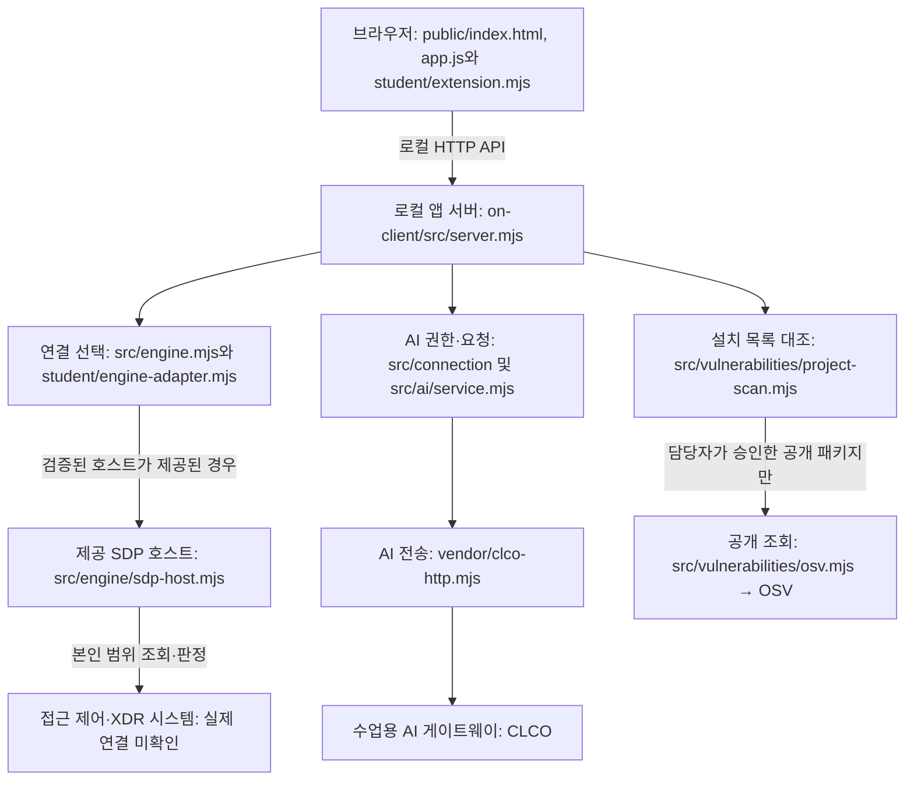

# 케셰브 학생 실행 설명서 — 21단계

이 문서는 학생이 작성한 실행·구조·장애 안내다. 제공 시작 틀의 README와 문서를 교체하지 않는다. 케셰브는 직원 본인의 계정·기기·현재 연결, 업무 앱 접근 판정, 최근 보안 기록과 참고용 AI 설명을 구분해 보여 주는 로컬 앱이다. OSV 조회는 정확한 설치 버전의 알려진 취약점 정보이며 악성코드 검사·치료나 앱 전체의 안전 보장이 아니다.

실행 대상은 저장소 안의 **`on-client`**다. 저장소 루트의 `package.json`, `api/`, `public/`, `src/`는 앞선 1~12단계 자료실 프로젝트이므로 아래 실행 명령과 혼동하지 않는다. 앞 단계 파일·Git 기록은 보존한다.

## 1. 지원 환경과 실제 확인한 버전

확인일: 2026-11-03. 아래 실제 버전은 명령 출력으로 확인했다.

| 항목 | 실제 확인 | 코드·지원 범위 |
|---|---|---|
| 실행 환경 | 현재 Windows PC | 다른 PC와 Linux·macOS 실행은 미확인 |
| Node.js | `v24.13.1` | `on-client/package.json`의 기준은 `24.19.0`. 제공 실행 도구는 22~24를 허용하지만, 다른 버전의 실행은 이 문서에서 확인하지 않았다. |
| npm | `11.8.0` | `npm.cmd`로 문법 검사·예제·기본 실행 확인 |
| Git | `2.53.0.windows.1` | 기록·커밋·공식 원문 내보내기에 사용 |
| Windows PowerShell | `5.1.22621.4391` | 별도 `powershell.exe -NoProfile` 프로세스에서 아래 npm 명령 실행 |
| PowerShell 7 | `7.6.5` | 작업 터미널의 버전 확인. Windows PowerShell과 구분한다. |
| 브라우저 | 이번 단계에서 버전 미확인 | HTTP 응답 확인과 실제 브라우저 조작은 다르다. |
| 시작 틀 패키지 | `alekov-client-starter` `0.2.14` | `on-client/package.json`에서 확인 |
| 진단 응답의 version | `0.1.0` | `src/server.mjs`가 반환하는 별도 필드다. 패키지 버전과 같다고 간주하지 않는다. |

Node.js·npm·Git·PowerShell과 브라우저가 필요하다. 새 PC의 프로그램 설치 자체는 미실행이다. 설치가 필요하면 시작 틀의 [학생 실행 안내](STUDENT_LAUNCH_GUIDE.md)를 따른다. 이 앱의 `package.json`에는 외부 npm 의존성이 없으며, 서버는 Node 내장 모듈을 사용한다. 이 문서의 실행을 위해 `npm install`, 임의 패키지 추가·다운그레이드, 인증 설정 변경을 실행할 필요는 없다. 저장소 루트의 기존 lock 파일을 변경하지 않는다.

## 2. 폴더와 PowerShell을 여는 위치

현재 PC에서 확인한 저장소 최상위 위치:

```text
C:\Users\USER\Documents\ChatGPT\aleph\stage13-vault
```

다른 PC에서는 자신이 받은 저장소의 실제 위치로 바꾼다. 예전 작업 폴더에 시작 틀을 다시 덮어쓰지 않는다.

```text
stage13-vault/                         Git 최상위: 커밋·원문 도구 실행 위치
├─ README.md                          앞 단계 기록 + 학생 실행 안내 링크
├─ AGENTS.md                          작업 보존 규칙
├─ api/, public/, src/, package.json   1~12단계 프로젝트: 아래 명령의 실행 대상 아님
└─ on-client/                         앱 실행 위치
   ├─ package.json                    start / demo / check 명령
   ├─ .env.example                    비밀 없는 설정 견본
   ├─ student/extension.mjs            학생의 화면 표시 함수 8개
   ├─ student/engine-adapter.mjs       제공된 본인 범위 연결 어댑터
   ├─ public/index.html, app.js        제공 UI·메뉴·요청·상태 관리
   ├─ public/ai-connect.mjs            제공 승인 진행 화면
   ├─ public/vulnerabilities-view.mjs  제공 OSV 응답 검사·화면
   ├─ src/server.mjs                  로컬 HTTP 서버
   ├─ src/engine.mjs                   기본 미연결 / 예제 엔진
   ├─ src/engine/                     SDP 호스트 계약·설정 검사
   ├─ src/connection/                 계정 연결·승인 관리
   ├─ src/ai/                         앱 권한 검사·AI 요청·보관함 연결
   ├─ src/actions/                    제공 조치 서비스: 기본 미지원
   ├─ src/vulnerabilities/            설치 목록 대조·승인된 공개 OSV 조회
   ├─ vendor/clco-http.mjs             제공 AI 게이트 전송 구현
   ├─ tools/start-alekov.ps1           제공 실행 도구
   └─ docs/STUDENT_RUNBOOK.md          이 학생 문서
```

새 PowerShell 창에서 앱 폴더로 이동한다. 파일 탐색기에서 이 `on-client` 폴더를 열고 주소 표시줄에 `powershell`을 입력해도 된다.

```powershell
Set-Location -LiteralPath 'C:\Users\USER\Documents\ChatGPT\aleph\stage13-vault\on-client'
Get-Location
node --version
npm.cmd --version
git --version
$PSVersionTable.PSVersion
npm.cmd run check
```

`Get-Location`이 `on-client`로 끝나야 한다. `check`는 `node --check student/extension.mjs` 문법 검사이며 화면 동작·서버 연결·공식 통과 검사가 아니다.

## 3. 실행·종료·재실행

### 예제 화면 실행 — 실제 연결 성공이 아님

앱 폴더에서 실행한다. 실제 자격이나 프로젝트 설정 없이 제공 예제 자료를 사용한다.

```powershell
npm.cmd run demo
```

정상 시작 신호는 `케셰브 예제: http://127.0.0.1:5189`다. 브라우저에서 **http://127.0.0.1:5189/** 를 연다. 예제 모드는 `demo`이며 실제 계정·AI·운영 시스템 연결 성취가 아니다. 예제 계정은 `practice-user`, 기기는 `practice-pc`, 세션은 `practice-session`이다. 기기 `unknown`을 정상으로 바꾸지 않는다.

### 기본 실행 — 연결 상태를 그대로 확인

예제 서버를 종료한 뒤 같은 앱 폴더에서 실행한다.

```powershell
npm.cmd start
```

실행 명령은 `node src/server.mjs`다. 기본 주소는 같은 **http://127.0.0.1:5189/** 이며 시작 신호는 `케셰브 연결 확인: ...`다. **이 문구만으로 실제 연결 성공을 뜻하지 않는다.** 이번 검증에서 기본 실행의 엔진은 `disconnected`, `/api/me`는 HTTP 503 `ENGINE_NOT_CONNECTED`였다. 기본 미연결을 예제 사용자나 빈 성공으로 바꾸지 않는다.

### 이미 5189 포트를 사용하고 있을 때

기존 프로세스를 임의 종료하지 않는다. 앱 폴더의 새 PowerShell에서 이번 창에만 포트를 지정한다. 이번 문서 검증에서는 다음 명령과 **http://127.0.0.1:5196/** 를 사용했다.

```powershell
$env:ON_PORT = '5196'
npm.cmd run demo
```

같은 창의 기본 실행도 `npm.cmd start`로 5196을 사용한다. 5196도 사용 중이면 다른 사용하지 않는 포트를 고르고, 출력된 주소의 포트와 브라우저 주소를 일치시킨다. 원래 기본 포트로 돌아가려면 서버를 종료한 뒤 이 창에서만 설정을 제거한다.

```powershell
Remove-Item Env:ON_PORT -ErrorAction SilentlyContinue
```

### 종료하고 다시 실행하기

서버를 실행한 터미널에서 **Ctrl+C**로 중지한다. `npm.cmd`가 배치 종료 여부를 묻는 환경이라면 종료를 확인한다. 시작 프롬프트로 돌아온 뒤 같은 명령을 다시 실행하고, 출력된 주소를 브라우저에서 다시 연다. 브라우저 탭만 닫으면 서버가 종료되는 것은 아니다. 5189의 다른 작업·보관함·데이터를 삭제하거나 전체 Node 프로세스를 종료하지 않는다.

이번에는 별도 Windows PowerShell 프로세스에서 예제 실행 → HTTP 확인 → 도구를 통한 인터럽트 종료 → 5196 포트의 응답 중지 확인 → 기본 실행 → HTTP 확인 → 종료를 수행했다. 사람이 새 그래픽 창에서 Ctrl+C를 누르는 전체 절차는 미확인이다.

### 제공 실행 도구와 설정 경계

다음은 제공 안내에 있는 실행 도구다. 파일·옵션·22~24 버전 검사·포트 검사를 **원문에서 확인**했지만, 이번 21단계에는 아래 도구 자체를 실행하지 않았다.

```powershell
powershell -NoProfile -ExecutionPolicy Bypass -File .\tools\start-alekov.ps1
```

이 도구의 기본 실행은 계정 연결용 로컬 보관소 준비도 수행한다. 위의 단순 `npm.cmd start`와 같은 승인 준비를 했다고 간주하지 않는다. 계정 승인 동선과 옵션은 [제공 실행 안내](STUDENT_LAUNCH_GUIDE.md), [SDP 연결 안내](SDP_HOST_CONNECTION.md), [AI 준비 안내](AI_SETUP_GUIDE.md)를 따른다. `-ExecutionPolicy Bypass`는 해당 실행에만 적용되며 전역 정책 변경 안내가 아니다.

`.env.example`은 견본이다. `npm.cmd start`는 `.env`를 자동으로 읽는 명령으로 정의돼 있지 않다. 서버 시작 코드는 `process.env`와 명시적으로 선택한 호스트 설정을 읽는다. 환경변수·허용 패키지·대상 경로·실제 계정 연결을 학생이 임의 변경하지 않는다. 키·토큰·비밀번호는 문서·화면·Git·원문 묶음에 넣지 않고, 제출에서 제외되는 로컬 설정이나 제공 보관함에서만 관리한다. 값 자체를 AI에 보내지 않는다.

### 화면에서 직접 확인할 위치 — 이번에는 브라우저 조작 미확인

1. `보호 현황`·`업무 앱`·`보안 기록` 메뉴가 있다. 마우스로 선택하거나 Tab으로 메뉴에 진입한 뒤 위·아래 방향키와 Enter를 사용한다. 메뉴별 패널 전환은 제공 `app.js`의 `setupNav`·`selectView`가 담당한다.
2. 예제 실행의 `보호 현황`에서 제공 계정과 학생 영역의 `practice-user`·`practice-pc`·`practice-session`을 비교한다. `다시 불러오기`를 누르면 받은 현재 값으로 다시 그린다. 기본 실행의 미연결은 예제 계정으로 대체하지 않는다.
3. 예제 `업무 앱`에는 앱별 `접속 요청` 버튼이 있다. 선택 앱의 제공 판정과 학생의 판정·이유·시각을 비교한다. 실제 계정에서 모든 판정을 보기 위해 정책을 바꾸지 않는다.
4. `보안 기록`의 학생 영역에는 `기록 종류`·`업무 앱`·`접속 상태` 필터와 `<event.id> 상세` 버튼이 있다. 표시 건수·근거·규칙·상태를 확인한다. 기본 예제의 지원 조치는 0개이며 실제 집행 버튼이 열리지 않는 것이 정상이다.
5. `보호 현황`의 `도움정보 불러오기`를 누른 뒤 학생 상태 칸의 `도움정보 복사`를 직접 누른다. 복사 대상은 `requestId·component·version·checkedAt·engine.mode·engine.code`뿐이다. 제공 복사 버튼은 별도이며 학생 버튼을 대신하지 않는다.
6. `설치 패키지 조회`와 `패키지 조회 취소`는 제공 조회 버튼이다. 학생 표의 정확한 버전을 담당자가 지정한 대상의 `package-lock.json`과 대조한다. 기본 미설정·미조회는 조회 성공으로 쓰지 않는다. 외부 조회 허용 대상이 준비되지 않았으면 패키지명·대상 설정을 임의 추가하지 않는다.

실제 계정 승인·`AI 연결 점검`·`현재 API 연결 점검`·사건의 `AI 설명 요청`·조치 집행은 이 문서 작성에서 실행하지 않았다. 별도 준비·권한과 수동 확인이 필요한 경로다.

## 4. 시스템 구성과 요청 경로

아래는 **코드의 연결 관계**다. 화살표가 실제 운영 연결 완료를 뜻하지 않는다.



| 경계 | 실제 파일·공개 주소 | 데이터와 확인 범위 |
|---|---|---|
| 브라우저 → 로컬 서버 | `on-client/public/app.js` → `on-client/src/server.mjs`, `http://127.0.0.1:5189/` (검증 포트 5196) | `/api/me`, `/api/apps`, `/api/events`, `/api/devices`, `/api/sessions` 조회. `/api/access`는 선택 앱 접근 판정 요청. 루프백 서버다. |
| 로컬 서버 → 접근 제어·XDR | `src/engine.mjs`, `student/engine-adapter.mjs`, `src/engine/sdp-host.mjs` (모두 `on-client` 아래) | 기본은 미연결. 예제는 `demoEngine()`의 가상 자료다. 실제 시스템의 개인 연결 주소·설정값은 문서에 기록하지 않는다. 실제 운영 연결은 미확인이다. |
| 로컬 서버 → AI 게이트웨이 | `on-client/src/ai/service.mjs` → `on-client/vendor/clco-http.mjs`; 제공 연결 상수는 `src/ai/connection.mjs`의 `https://ai-classroom-gateway-production.up.railway.app` | 브라우저의 `/api/ai/check`, `/api/ai/explain`을 서버가 처리한다. 실제 앱 권한과 모델 허용 검사를 거치며, 기본 실행의 원격 호출 성공은 미확인이다. |
| 승인 포털 | `on-client/src/ai/connection.mjs`, `https://aleph-omega.vercel.app` | 제공 화면의 계정 연결·앱 승인에 사용되는 공개 주소. 문서에 확인 번호·인증값을 저장하지 않는다. |
| 로컬 서버 → OSV | `on-client/src/vulnerabilities/project-scan.mjs`, `osv.mjs`, `https://api.osv.dev/v1/querybatch` | `package-lock.json`과 설치 메타데이터를 대조하고 승인된 공개 이름·정확한 버전만 조회한다. 비공개 이름을 확인하려고 외부에 보내지 않는다. 이번 검증에서는 외부 호출하지 않았다. |
| 조치 경계 | `on-client/src/actions/`와 제공 UI | 준비·사람 확인·ACK·결과 재조회 담당. 학생 함수에는 확인 티켓이 전달되지 않는다. 실제 학생 계정의 집행기·효과 관측은 기다림(UNV)이다. |

Workbench 수업용 AI는 개발 도움, 케셰브 앱 안 AI는 선택한 사건의 참고 설명, ALEPH의 판정 AI는 제출 커밋의 원문 검토 역할이다. 모델 목록·연결 점검 응답이 사건 설명 실행이나 공식 과제 통과를 뜻하지 않는다.

## 5. 학생 구현과 제공 코드의 경계

학생 구현은 `on-client/student/extension.mjs`의 `createStudentView()`가 반환하는 함수다. 제공 `public/app.js`가 현재 입력을 전달하고 반환 DOM으로 학생 영역을 교체한다. 학생 화면은 `createElement`와 `textContent`를 사용한다.

| 학생 함수 | 표시하는 입력·기능 | 이 함수가 하지 않는 일 |
|---|---|---|
| `renderIdentity` | `me·devices·sessions`의 상태, 계정·현재 기기·세션과 원래 상태 코드 | 인증·기기 승인·악성코드 치료 |
| `renderDecision` | 선택 앱의 `appId·decision·reason·checkedAt`, 요청 실패 | 실제 앱 접속 성공 보장·추가 인증 대행 |
| `renderEvents` | 전달된 최근 기록 복사·최신순 정렬, 세 필터, 근거·규칙·세 상태 상세 | 전체 직원 로그 조회·새 XDR 탐지·조치 전송. 미지원 버튼은 상세에서 비활성 표시만 한다. |
| `renderStatus` | 기기·현재 검증된 연결 한 개·알림, 진단 허용 필드와 수동 복사 | 진단 API 직접 조회·자동 재요청. 복사는 `도움정보 복사` 클릭 때만 한다. |
| `renderAiConnection` | `test/verified`, 모델 수·시각, 권한·인증·한도·취소 등 안전 안내 | 승인·유료 모델 호출·사건 설명 성공으로 간주 |
| `renderExplanation` | 현재 사건 근거 ID와 문장 대조, 규칙·상태·참고 요약·미실행 제안 | 없는 근거 생성·실행 버튼 추가·보안 조치 집행 |
| `renderAction` | 사건·근거·대상·세대·요청·영수증·버전, 준비·전송·ACK·효과 관측 구분 | POST·티켓 보관·재집행. `succeeded`와 `effectApplied === true`일 때만 효과 확인 표시 |
| `renderVulnerabilities` | 전체·패키지 상태, 정확한 버전·OSV 출처·시각·ID, 일부 실패 시 받은 ID 유지 | 패키지 설치·다운그레이드·조회 허용 확대·안전 보장 |

메뉴·서버 API·응답 검사·요청 세대 관리·취소·원격 전송·권한·보관함·설정 검사는 제공 코드다. 이 문서 작성에서 제공 코드·학생 UI·인증 설정을 수정하지 않았다. 과거 기록 목록은 본인의 최근 최대 40건이며, 현재 연결 조회를 과거 세션 전체 목록으로 해석하지 않는다.

## 6. 확인한 기능과 미확인 기능

| 증거 구분 | 실행·검토 내용 | 결과와 한계 |
|---|---|---|
| 이번 단계 실제 명령 | 새 Windows PowerShell 프로세스에서 `npm.cmd run check` | 정상 종료. 학생 파일 문법만 검사 |
| 이번 단계 실제 실행·HTTP | 5196에서 `npm.cmd run demo`; `/`, `/student/extension.mjs` | HTTP 200. 브라우저 렌더링·키보드 조작은 이번에 확인하지 않음 |
| 이번 단계 실제 HTTP | 예제 `/api/me`, `/api/events`, `/api/diagnostics` | 계정 응답 `ok:true`, `mode:demo`; 기록 1건과 지원 조치 0건; 진단 엔진 `demo`. 개인정보 대신 제공 예제만 사용 |
| 이번 단계 실제 실행·HTTP | 예제 종료 후 5196에서 `npm.cmd start`; `/`, `/api/me`, `/api/diagnostics` | 루트 200; 계정 503 `ENGINE_NOT_CONNECTED`; 진단 `disconnected`. 이는 기본 미연결 확인이다. |
| 이번 단계 실제 종료 확인 | 각 명령 세션에 인터럽트 후 5196 HTTP 확인 | 두 검증 서버 모두 응답 중지. 기존 5189 서버는 종료하지 않음 |
| 이전 단계 모의 검사 기록 | 13~20단계의 DOM 입력·필터·상태·오류·근거 대조와 제공 UI의 늦은 응답 폐기·수동 재시도 | 실제 계정·외부 OSV·유료 AI·조치 효과의 증거가 아니다. 당시 검사 스크립트는 임시 실행했고 저장소에 테스트 명령으로 등록하지 않았다. |
| 코드 원문 검토 | 함수·입력 계약, 버튼 이름, `.env.example`, 서버 시작·연결 분기, 제공 실행 도구 | 소스와 문서 정합성 검토. 실행 성공 인증과 구분 |
| 미확인 | 다른 PC·깨끗한 재설치, Node 24.19.0, Linux·macOS, 이번 단계의 실제 브라우저 조작·클립보드 | 확인했다고 표시하지 않음 |
| 미확인 / 기다림(UNV) | 실제 계정 승인·SDP/XDR 연결·AI 앱 권한 및 사건 설명·외부 OSV 조회·실제 조치 집행과 같은 대상의 결과 확인 | 제공 연결·운영 권한과 별도 증거가 필요함. 운영자 자격이나 임의 집행기 구축을 학생에게 요구하지 않음 |
| 공식 판정 | ALEPH 서버의 단계별 통과·진도 | 여기서 조회·인증하지 않음. 원문 제출 완료와 통과는 다르다. |

## 7. 오류별 확인·복구 순서

| 증상·코드 | 먼저 확인 | 복구·예상 결과 |
|---|---|---|
| `package.json` 없음, `Missing script` | `Get-Location`이 `on-client`인지, 그곳의 `package.json`에 `start/demo/check`가 있는지 | 실제 앱 폴더로 이동해 같은 명령 재실행. 루트 프로젝트를 바꾸지 않는다. |
| `node` 또는 `npm.cmd`를 찾지 못함 | 새 창에서 버전 명령 | 프로그램 준비 후 새 PowerShell에서 확인. 설치 자체는 이번 검증 범위 밖이다. |
| `npm.ps1` 실행 정책 오류 | `npm` 대신 문서의 `npm.cmd`를 사용했는지 | `npm.cmd` 사용. 전역 보안 정책을 낮추지 않는다. |
| `EADDRINUSE` 또는 포트 사용 중 | 출력된 포트와 이미 실행 중인 앱 | 다른 작업을 중단하지 말고 새 창에서 사용하지 않는 `ON_PORT`로 실행. 이번 5196 실행은 정상 응답을 확인했다. |
| `ERR_CONNECTION_REFUSED` | 실행 터미널이 남아 있는지, 포트가 출력 주소와 일치하는지 | 앱 폴더에서 직접 다시 실행하고 출력 주소로 열기. 이전 화면만으로 서버 생존을 판단하지 않는다. |
| Node SQLite `ExperimentalWarning` | 경고 뒤 시작 문구와 루트 HTTP 응답 | 이번 환경에서는 경고 후 정상 시작했다. 경고만으로 운영 연결 성공·실패를 단정하지 않는다. |
| `ENGINE_NOT_CONNECTED` | 기본 실행인지 예제 실행인지, 제공 연결의 준비 상태 | 기본 미연결은 담당자 연결 확인 대상. 화면 연습은 명시적으로 `demo` 사용하고 실제 연결이라고 쓰지 않는다. |
| `CONTRACT_MISMATCH` | 제공 오류 코드와 학생 영역이 이전 값을 지웠는지 | 현재 응답 형식을 담당자에게 확인. 실패를 빈 정상 목록으로 바꾸지 않는다. |
| 일반 조회 `TIMEOUT`·취소 | 현재 요청 상태와 버튼 | `다시 불러오기` 또는 해당 조회 버튼을 사용자가 직접 눌러 재시도. 자동 요청·늦은 결과 재사용 금지 |
| AI 권한 준비·인증·접근 제한 | `ON_AI_PROVISIONING_PENDING`, `WB_CLCO_AUTH_REQUIRED`, `WB_CLCO_ACCESS_BLOCKED` 등 안전 코드 | 계정 연결·앱 승인과 담당자 권한 확인. Workbench나 다른 사용자의 키를 옮기지 않는다. |
| AI 한도·시간·모델 없음 | 반 사용량·이용 시간·허용 모델 코드 | 담당자 확인. 자동 반복·대체 모델·임의 인증 설정을 추가하지 않는다. |
| AI 근거 불일치·`executed:true` | 선택 사건 ID, 인용 ID, 현재 근거 | 설명을 사용할 수 없다는 안내와 성공 속성 제거가 정상. 보안 기록·접근 판정은 별도로 유지한다. |
| 진단 복사 실패 | 학생 영역의 복사 결과 문구 | `도움정보 불러오기` 후 학생 칸의 `도움정보 복사`를 직접 누른다. 실패하면 표시된 안전 필드만 수동 선택해 복사한다. 브라우저 권한 변경은 임의 수행하지 않는다. |
| OSV `not_configured/not_checked/unverifiable/partial` | 대상 설정 유무, 승인 대상 유무, lock·설치 메타데이터, 받은 ID | 담당자 확인 또는 직접 재조회. 미조회·실패를 취약점 없음으로 해석하지 않고 받은 ID는 보존. 의존성을 낮추거나 허용 목록을 확대하지 않는다. |
| 조치 `ACTION_UNSUPPORTED` | 현재 기록의 `supportedActions` | 현재 실제 목록은 지원 조치가 없어 준비 버튼이 없는 것이 정상. 실행 경로를 임의로 열지 않는다. |
| 조치 `unknown`·`ACTION_TIMEOUT` | 현재 requestId·receiptId·관측 상태 | 성공·효과 없음으로 단정하지 말고 제공 화면의 `원천 결과만 재조회`로 결과만 확인. 재집행하지 않는다. `조치 화면 취소`는 이미 전달된 효과의 복구가 아니다. |

기본 실행과 예제 실행의 응답은 구분한다. `none_found`는 조회 범위·시점에 알려진 항목이 없다는 뜻이지 모든 위험 부재가 아니다. ACK는 실제 효과가 아니다.

## 8. 제출할 커밋과 원문 묶음

21단계는 문서와 현재 학생 코드를 같은 커밋 트리에 담는다. 이미 추적된 학생 코드는 새로 수정하지 않아도 그 커밋에 포함된다. 제공 README·문서를 덮어쓰지 않는다. 커밋 전 `git status`와 변경 파일을 보고 다른 작업을 보존한다. 실제 비밀 파일·보관함·설정 원문을 추가하지 않는다.

21·22단계의 저장소 주소와 40자리 커밋은 과제 화면에서 직접 입력한다. 현재 안내의 Workbench `포털 제출 준비`는 13~20단계용이다. 비공개 저장소를 공개로 바꾸지 않는다.

공식 원문 ZIP과 JSON 출력은 이 저장소 밖에 둔다. 도구는 커밋된 원문만 내보내며 학생 코드 실행·업로드·제출을 하지 않는다. 과제 화면의 최신 `원문 전달 도구 받기`와 사용법을 우선하고, 실제 확인한 도구 경로와 출력 폴더를 사용한다. 커밋 번호를 문서가 자기 자신의 해시로 미리 주장하지 않는다.

이번 PC에서 기존 공식 도구는 다음 위치에 있으며, 이전 단계의 내보내기 실행과 원문 대조 기록이 있다.

```text
C:\Users\USER\Documents\ChatGPT\aleph\tmp\stage17-source-tool\alekov-source-tool\student-source-cli.mjs
```

이번 커밋이 생성된 **뒤**, 아래 명령을 **Git 최상위 폴더**의 PowerShell에서 실행한다. `$stage21Commit`은 실제 HEAD의 40자리이며, 출력 폴더는 미리 만들고 파일은 새 이름을 사용한다. 기존 파일을 덮어쓰지 않는다.

```powershell
Set-Location -LiteralPath 'C:\Users\USER\Documents\ChatGPT\aleph\stage13-vault'
git status --short
$stage21Commit = (git rev-parse HEAD).Trim()
node 'C:\Users\USER\Documents\ChatGPT\aleph\tmp\stage17-source-tool\alekov-source-tool\student-source-cli.mjs' --commit $stage21Commit --output 'C:\Users\USER\Documents\ChatGPT\aleph\output\stage21-source.json'
```

이 구체적인 21단계 명령은 문서 초안 시점에는 미실행이다. 실제 실행 결과·커밋 해시·생성 파일은 커밋 후 작업 보고에서 따로 확인한다. 출력 JSON의 저장소·커밋이 입력란과 일치해야 한다. `비공개 저장소 원문 묶음`에서 파일을 선택하고 **21단계**인지 확인해 사용자가 제출한다. 원문 전달만 실패하면 기존 접수를 보존하고 `원문만 다시 보내기`를 사용한다. JSON 생성·전달은 공식 통과를 뜻하지 않는다.

## 9. 22단계의 새 폴더 재현 기록

위 21단계 확인 이력은 당시의 기록으로 보존한다. 최종 제출 버전의 별도 복제·재현·데이터 보존 계획은 [학생 릴리스 기록](STUDENT_RELEASE.md)을 따른다. 새 복제본의 경로를 기준으로 실행하며 원래 폴더의 개인 인증·설정 파일을 그대로 복사하지 않는다. `student-reproduce-check.mjs`는 현재 커밋 해시와 코드 해시가 결속된 별도 결과 JSON을 만들며, 그 모의·로컬 결과를 실제 브라우저·운영 인증으로 해석하지 않는다.
